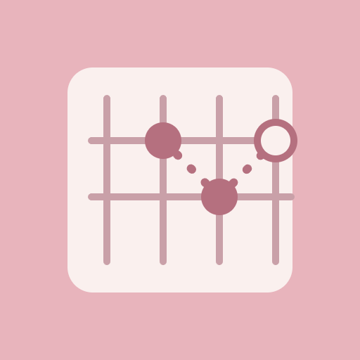

# Chord Compass

Tap the fretboard, name your chord, and find what sounds good next.

- ▶ **Try it:** https://chiya-miyai.github.io/chord-compass/
- 🎬 **Demo video:** https://chiya-miyai.github.io/chord-compass/demo.mp4
- 🎤 **Pitch video:** https://chiya-miyai.github.io/chord-compass/pitch.mp4
- 📄 **Pitch deck (PDF):** [pitch.pdf](pitch.pdf)

## About

### Finding the next chord is hard

Many guitar beginners can play a chord but do not know its name, or which chord sounds good after it.

- You hold a shape, but what chord is it?
- Music theory feels hard to read
- Chord Compass names it and suggests what to play next

### Tap, see, and follow the cards

Tap the fretboard to place notes. The app names the chord, then shows next chords with a reason for each.

- Tap strings and frets, or use open and mute marks
- See the chord name, type, and its notes
- Suggestion cards give a reason and shared notes
- Tap a card to show the chord and save your path

### Soft design, made your way

Chord Compass makes theory feel friendly, with calm pastel colors and a simple screen.

- Three themes: pink, lavender, and mint
- Switch between Japanese and English
- Quick buttons for common chords, and a play button
- Next: a new logo, and saving your progressions

## How it was made

Built by shaping the idea together with AI (Claude) and publishing the AI-written code.
The full conversation is in [IDEA.md](IDEA.md) (Japanese).

## Files

- `index.html` — the app (a single self-contained file)
- `IDEA.md` — the idea log
- `pitch.pdf` — the pitch deck
- `assets/logo.png` — the logo
